# 🚀 Awesome Continuous Data Ingestion

  

  
  
  
  
  
  

---

## 📖 Overview & SEO Summary

A meticulously curated directory of top **Continuous Data Ingestion**, **Change Data Capture (CDC)**, **Real-Time Streaming Pipelines**, and **Modern ELT** platforms. Whether evaluating fully managed cloud SaaS platforms for enterprise scale or self-hosted, open-source ingestion engines with zero vendor lock-in, this list provides comprehensive technical benchmarks, pricing transparent breakdowns, and architecture guides.

**Key Topics Covered:** `data-ingestion` • `change-data-capture` • `elt` • `streaming-data` • `data-engineering` • `apache-kafka` • `apache-flink` • `real-time-analytics` • `lakehouse`

🌟 **Star this repository if you find it helpful!** 🌟

*Last updated: November 2026*

---

## 📑 Table of Contents

- [📊 Sector Overview & Market Dynamics](#-sector-overview--market-dynamics)
- [☁️ SaaS & Hosted Platforms](#️-saas--hosted-platforms)
- [💻 Open-Source GitHub Projects](#-open-source-github-projects)
  - [Top Projects (Ranked by Stars)](#top-projects-ranked-by-stars)
  - [Specialized & Lightweight CDC Tools](#specialized--lightweight-cdc-tools)
- [🤝 How to Contribute](#-how-to-contribute)
- [💖 Support & Sponsorship](#-support--sponsorship)
- [📈 Star History](#-star-history)
- [⚠️ Disclaimer & Architecture Guide](#️-disclaimer--architecture-guide)

---

## 📊 Sector Overview & Market Dynamics

The continuous data ingestion and real-time data integration sector is estimated at **$15B–$20B** (projected to reach **$30B–$50B+ by the 2030s** at an estimated 10%–13% CAGR), driven by enterprise demands for streaming pipelines, log-based CDC replication, and AI-ready real-time data stores. The sector features a **concentrated core with a moderately fragmented perimeter**: hyperscalers and top data platform incumbents (AWS, Google Cloud, Snowflake, Confluent) capture the lion's share of enterprise platform spend, while specialized ELT/CDC SaaS vendors compete in a moderately fragmented layer differentiated by connector breadth, zero-maintenance ingestion, and streaming speed.

---

## ☁️ SaaS & Hosted Platforms

| Company / Product | Scale (Valuation / Revenue) | Starting Pricing | Free Tier / Free Trial Limits | Key Features & Best For |
|---|---|---|---|---|
| **[Google Cloud Dataflow](https://cloud.google.com/dataflow)** | **$3.8T+ Market Cap** (Alphabet Inc. Parent Valuation; ~$350B+ annual revenue) | **~$0.069/vCPU-hr** (streaming worker) & **~$0.056/vCPU-hr** (batch worker) + $0.003557/GiB-hr memory | **$300 credit free trial** valid for 90 days across Google Cloud; capped at 8 max cores during trial | Managed Apache Beam engine for unified stream/batch pipelines with horizontal autoscaling; best for GCP-native workloads. |
| **[AWS Kinesis Data Firehose](https://aws.amazon.com/kinesis/data-firehose/)** | **$2.7T+ Market Cap** (Amazon Parent Valuation; AWS standalone run-rate ~$184B ARR) | **$0.029 per GB** ingested (first 500 TB/month; calculated in 5 KB increments) | **No dedicated permanent free tier**; new accounts get standard AWS Free Tier credits (usage billed from first GB) | Fully managed serverless delivery of streaming data to S3, Redshift, OpenSearch, and Splunk without consumer management. |
| **[Snowflake Snowpipe](https://www.snowflake.com/)** | **~$110B–$118B Market Cap** (NYSE: SNOW; ~$4.7B annual revenue) | **0.0037 Snowflake credits per GB** loaded (~$0.0074 to ~$0.0148/GB based on $2–$4/credit edition pricing) | **$400 free usage credits** valid for 30 days (full access to platform, Snowpipe, and virtual warehouses) | Serverless, low-latency continuous file ingestion from S3, GCS, and Azure Blob storage directly into Snowflake tables. |
| **[Confluent Cloud](https://www.confluent.io/)** | **$11B Valuation** (Acquired by IBM; ~$1B+ ARR) | **$0/hr base (scales to zero when idle)**; active usage starts at **$0.14/eCKU-hour** + $0.10/GB ingress | **$400 free credit trial** valid for 30 days with no cluster capacity commitments required | Fully managed Apache Kafka service with built-in connectors, stream processing (ksqlDB / Apache Flink), and schema registry. |
| **[Qlik Replicate](https://www.qlik.com/)** | **~$10B Valuation** (Thoma Bravo & sovereign equity backing; $200M+ cloud integration ARR) | Custom enterprise licensing; entry-level deployments start around **~$1,000/month** or quote-based capacity tiers | **No self-service free tier or open trial**; enterprise evaluation is offered strictly via sales-guided Proof of Concept (PoC) | Enterprise-grade Change Data Capture (CDC) and replication supporting legacy/mainframe architectures, SAP, and relational DBs. |
| **[Fivetran](https://www.fivetran.com/)** | **$5.6B Valuation** (Series D; $300M+ ARR) | Pay-as-you-go starting at **~$500 per million MAR** (Monthly Active Rows) with a **$5/month base charge** | **Free tier: 500,000 MAR/month forever** (up to 3,500 MAR for activations, 5,000 transformation model runs, 15-min syncs) | Zero-maintenance managed ELT platform featuring 500+ connectors with automated schema drift handling and normalization. |
| **[Airbyte Cloud](https://airbyte.com/)** | **$1.5B Valuation** (Series B unicorn) | **$20/month** (Standard plan base, includes ~5 credits; additional credits at $5/credit; 6 credits/1M API rows or 4 credits/1GB DB sync) | **14-day free trial capped at 400 credits** (~100 GB database syncs; no credit card required); self-hosted open-source version is free forever | Cloud-hosted engine backed by 600+ open-source connectors, no-code Connector Builder, and Agent SDK for AI workloads. |
| **[Matillion](https://www.matillion.com/)** | **$1.5B Valuation** (Series E unicorn; ~$80M–$100M revenue) | Consumption-based credit model; AWS Marketplace hourly rate starts at **~$2.00–$3.50/credit** (~1 credit/task-hr orchestration) | **14-day free trial with 500 usage credits** (available on sample environments or connected cloud warehouses) | Cloud-native visual ELT push-down transformation platform designed for Snowflake, BigQuery, Databricks, and Redshift. |
| **[Hevo Data](https://hevodata.com/)** | **~$45M–$47M Annual Revenue** (~$43M total venture funding) | **$265/month** billed annually ($299 billed monthly) for the Starter Plan (5M events/month) | **Free tier: 1 million events/month forever** (up to 5 users, limited connectors, 1-hr scheduling) + 14-day full feature trial | Low-maintenance, no-code continuous data pipeline platform offering real-time CDC with 150+ source integrations. |
| **[Estuary Flow](https://estuary.dev/)** | **~$100M–$250M Valuation** ($17M Series A; ~$1M–$10M revenue) | **$0.50 per GB** transferred on Cloud plan beyond free tier limits | **Free tier: 10 GB/month data transfer forever** and up to **2 active connector tasks** (no credit card required) | Real-time streaming ETL/CDC platform built on Gazette streaming broker, delivering millisecond data synchronization. |

---

## 💻 Open-Source GitHub Projects

### Top Projects (Ranked by Stars)

- **[Apache Spark](https://github.com/apache/spark)**   
  **Unified engine for large-scale data analytics and Structured Streaming** (Apache 2.0). Provides fault-tolerant, exactly-once continuous stream processing over massive datasets with native connectors for Kafka, Delta Lake, Apache Iceberg, and cloud object stores. **Best for**: high-throughput batch and micro-batch/continuous stream processing unified under a single API.

- **[Apache Kafka](https://github.com/apache/kafka)**   
  **Distributed event streaming platform** (Apache 2.0). Serves as the central backbone for continuous data ingestion, CDC pipelines, and event-driven architectures. Features KRaft consensus mode, Kafka Connect for plug-and-play source/sink connectors, Kafka Streams, and durable partitioned logs. **Best for**: central event bus infrastructure with durable replayability.

- **[Apache Flink](https://github.com/apache/flink)**   
  **Stateful stream processing framework** (Apache 2.0). The industry standard for low-latency, true event-by-event continuous stream ingestion with stateful event-time handling, exactly-once checkpointing, and native Flink CDC connectors for database ingestion. **Best for**: complex real-time event analytics and low-latency continuous stream transformations.

- **[Vector](https://github.com/vectordotdev/vector)**   
  **High-performance observability and event data pipeline** (MPL 2.0). Written in Rust for ultra-low memory overhead and maximum throughput. Ingests, transforms, and routes logs, metrics, and event streams across hundreds of endpoints and warehouses. **Best for**: resource-efficient edge or sidecar telemetry and event log streaming.

- **[Airbyte](https://github.com/airbytehq/airbyte)**   
  **Open-source data movement engine for ELT pipelines and AI agents** (ELv2). Features 600+ pre-built connectors for APIs, databases, data warehouses, and vector stores, accompanied by a low-code Connector Builder and Agent SDK for continuous data retrieval into LLM architectures. **Best for**: widest catalog of plug-and-play connectors for continuous ELT data syncs.

- **[Apache Pulsar](https://github.com/apache/pulsar)**   
  **Multi-tenant, distributed messaging and streaming platform** (Apache 2.0). Employs a cloud-native architecture decoupling compute (Pulsar brokers) from stateful storage (Apache BookKeeper), with built-in geo-replication and Pulsar IO connectors. **Best for**: multi-tenant streaming infrastructure requiring isolated storage tiers and seamless scaling.

- **[Fluentd](https://github.com/fluent/fluentd)**   
  **Unified logging layer** (Apache 2.0, CNCF Graduated). Provides a comprehensive plug-and-play architecture for collecting and forwarding semi-structured JSON log events from web servers, apps, and databases into analytic storage destinations. **Best for**: unified log collection and routing across hybrid cloud deployments.

- **[Debezium](https://github.com/debezium/debezium)**   
  **Distributed log-based Change Data Capture platform** (Apache 2.0). The gold standard for non-intrusive database replication. Inspects transaction logs across MySQL, PostgreSQL, MongoDB, SQL Server, Oracle, and Db2 to capture sub-second row changes into Kafka topics or standalone streaming endpoints. **Best for**: low-latency, zero-loss database replication without polling overhead.

- **[Apache SeaTunnel](https://github.com/apache/seatunnel)**   
  **Next-generation high-performance distributed data integration engine** (Apache 2.0). Capable of synchronizing massive volumes of data daily with 100+ connectors, connector-independent Zeta engine, schema evolution, and multi-table CDC synchronization. **Best for**: high-throughput distributed batch and real-time CDC across heterogenous storage.

- **[Redpanda Connect (formerly Benthos)](https://github.com/redpanda-data/connect)**   
  **Resilient, high-performance stream processor** (Apache 2.0). Written in Go, it runs as an ultra-fast, stateless single-binary stream orchestrator connecting dozens of sources to sinks with an expressive mapping language (Bloblang) and backpressure management. **Best for**: lightweight, declarative streaming pipelines without heavy cluster orchestration.

- **[Apache Beam](https://github.com/apache/beam)**   
  **Unified programming model for batch and streaming pipelines** (Apache 2.0). Write pipeline logic once in Python, Java, or Go and execute it portably across modern execution runtimes (Apache Flink, Apache Spark, or Google Cloud Dataflow). **Best for**: multi-language data processing pipelines portable across cloud and self-hosted runners.

- **[Fluent Bit](https://github.com/fluent/fluent-bit)**   
  **Super fast, lightweight log, metric, and trace processor** (Apache 2.0). Built in C with minimal memory footprint (~few megabytes), optimized for Kubernetes, cloud, and IoT continuous event telemetry streaming. **Best for**: embedded edge devices and Kubernetes cluster sidecars.

- **[Apache NiFi](https://github.com/apache/nifi)**   
  **Visual dataflow automation and routing engine** (Apache 2.0). Provides a drag-and-drop browser UI for designing, monitoring, and controlling continuous dataflows with bidirectional provenance, dynamic prioritization, and backpressure monitoring. **Best for**: visual pipeline development, complex compliance routing, and granular data lineage.

- **[Apache Pinot](https://github.com/apache/pinot)**   
  **Real-time distributed OLAP datastore** (Apache 2.0). Designed to continuously ingest millions of events per second directly from streaming sources like Kafka and Kinesis, indexing them immediately for low-latency analytical queries. **Best for**: user-facing real-time analytics with sub-second ingestion-to-query latency.

- **[Meltano](https://github.com/meltano/meltano)**   
  **CLI-first, code-driven ELT integration engine** (MIT). Built upon the open Singer specification with 600+ Singer taps and targets, GitOps-ready configuration, and built-in integration with dbt and orchestrators. **Best for**: software-engineering-centric data teams desiring code-defined ELT pipelines.

- **[Apache Gobblin](https://github.com/apache/gobblin)**   
  **Unified data ingestion framework for big data lakes** (Apache 2.0). Originally created at LinkedIn, Gobblin handles continuous data ingestion from streaming and batch sources directly into HDFS, S3, and cloud lakes with self-serve compliance and state management. **Best for**: enterprise lakehouse ingestion with built-in compaction and schema governance.

- **[Apache InLong](https://github.com/apache/inlong)**   
  **One-stop, massive-scale data ingestion platform** (Apache 2.0). Developed at Tencent, InLong is designed to ingest over 40+ trillion data pieces daily across distributed reporting, queuing, sorting, and storage components. **Best for**: hyperscale streaming ingestion requiring integrated collection, buffering, and loading.

---

### Specialized & Lightweight CDC Tools

- **[rivet](https://github.com/rivet-data/rivet)**  — Single-binary data extraction and CDC tool. Features keyset reads, CDC on relational databases (MySQL, PostgreSQL, SQL Server), and direct loading to BigQuery/Snowflake/ClickHouse with automated reconciliation.
- **Kafka Connect JDBC Source** — Standard JDBC polling CDC connector via `WHERE updated_at > last_checkpoint`. Suitable for legacy databases where binary/transaction log access is disallowed.
- **oversync** — Configurable open-source data synchronization engine supporting Kafka, SurrealDB, JDBC, and MCP targets with field mapping transformations.

---

## 🤝 How to Contribute

Contributions are welcome! Please follow these simple steps:

1. 🍴 **Fork** the repository.
2. 🌿 Create a feature branch (`git checkout -b feature/new-ingestion-tool`).
3. 📝 Add your entry into `README.md` keeping alphabetical or star-ranked placement and descriptive format intact.
4. 💡 Ensure you include: Tool Name, URL, GitHub Repo, License, and Key Features / Best For description.
5. 🚀 Open a **Pull Request** with a concise summary of the addition.

---

## 💖 Support & Sponsorship

If this curated guide helps your data architecture decisions or saves your engineering team hours of research, please consider supporting the project:

- ⭐ **Star this repository** to improve visibility and help others discover it!
- 🍴 **Fork and share** with fellow data engineers, architects, and communities.
- ☕ **Buy a coffee & sponsor**: You can support ongoing maintenance via the [GitHub Sponsors Dashboard](https://github.com/sponsors/ishandutta2007).

Your support is deeply appreciated and keeps this ecosystem matrix continuously updated! 🙏

---

## 📈 Star History

---

## ⚠️ Disclaimer & Architecture Guide

- This is a **community-curated** technical index — not an exhaustive list or formal commercial endorsement.
- Continuous data ingestion platforms handling production workloads must adhere to data protection regulations (GDPR, CCPA, HIPAA) with strict encryption, network security, and compliance logging.
- **Understanding Architecture Roles:**
  - **ELT Platforms** (*Fivetran, Airbyte Cloud, Hevo, Matillion, Estuary*): Handle end-to-end extraction, schema normalization, and delivery into analytical warehouses/lakes.
  - **CDC Engines** (*Debezium, Qlik Replicate*): Non-intrusively stream raw row mutations from transaction logs without batch query performance degradation.
  - **Stream Processors** (*Apache Flink, Apache Spark Streaming, Apache Beam*): Provide stateful real-time aggregation, event-time windowing, and exactly-once transformations.
  - **Distributed Event Fabrics** (*Apache Kafka, Apache Pulsar*): Act as durable, replayable central storage backbones connecting data producers to consumer fleets.
  - **Visual Dataflow Engines** (*Apache NiFi*): Provide graphical orchestration, data provenance tracking, and enterprise routing.

---

  <b>Built for data engineers, platform architects, and organizations building continuous streaming infrastructure.</b> 
  Let's make Continuous Data Ingestion transparent, high-performance, and resilient.

